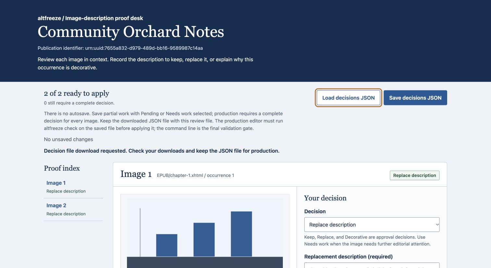
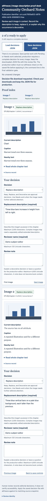

# Validation record

Date: 15 October 2026. This file distinguishes engineering validation from actual publishing accessibility approval. No customer adoption or production use is claimed.

## Independent AI review

A separate discovery agent challenged audience and competing workflows. A separate adversarial competition/code reviewer reported issues and then reviewed their repairs without editing application source. A separate acceptance reviewer authored 97 adversarial cases independently of the application's demo/writer. All reviews are AI-agent work, not separate human or GitHub account approvals.

The [initial code review](review-initial.md) and [focused final review](review-final.md) preserve findings and dispositions. They found corrupt image acceptance, inconsistent source reads, header/namespace/semantic ambiguities, strict-type and JSON error gaps, browser/CLI disagreement and overbroad timestamp invalidation. Regression tests and repairs are in the implementation PR. The final focused code review identified no remaining release-blocking code finding within the supported scope.

Local full suite: **146 passed**, Python 3.12.13, macOS ARM64, Pillow 12.3.0. The suite includes transactions, malicious archives/XML/JSON, Unicode, repeated-image identity, source and revision binding, shared-resource invalidation, new/removed records, post-apply lineage, browser validation parity and bounded resources. CI tests Python 3.10, 3.12 and 3.14 on Linux, macOS and Windows. The browser JavaScript harness uses Node when available and explicitly does not claim a real browser download test.

## Actual rendered review

The production review HTML was inspected in Chrome at a desktop viewport and at 390 × 844 pixels. Both raster previews decoded (480-pixel natural width), controls and proof sheets remained readable, and the mobile page had scrollWidth=390/innerWidth=390. Keyboard traversal reached labelled controls, a visible focus state and the following note field. Invalid/incomplete decorative review focused a useful error. Two complete replacement decisions showed 2/2 ready.

The actual Chrome download was copied into a separate engineering work area and passed `altfreeze check`. Applying that exact downloaded JSON produced an output EPUB; EPUBCheck 5.4.0 exited 0 with no errors or warnings. The page accurately says “download requested” and asks users to check downloads, since it cannot confirm completion.

Desktop and mobile evidence:

Browser automation policy blocks `file://` navigation. The current extension also lacks file-URL access needed for automated file selection, so direct local-file launch and real browser JSON re-import were **not automated or claimed as verified**. No extension/security settings were changed. Rendered checks used the exact self-contained generated HTML over loopback HTTP. Import behavior and rejection rules were executed through a DOM harness. The CLI accepts the downloaded file independently. No remote scripts, fonts, images or APIs are referenced; the page's CSP blocks connections.

The interface follows [Anthropic's frontend design guidance](https://github.com/anthropics/skills/blob/main/skills/frontend-design/SKILL.md): deliberate publication proof-desk styling, restrained palette, responsive hierarchy, visible focus and clear actions. That guidance is design input, not an accessibility certification.

## Independent EPUB fixture

The official [IDPF EPUB 3 samples release 20230704](https://github.com/IDPF/epub3-samples/releases/tag/20230704) supplies `epub30-spec.epub`, SHA-256 `def6a7a1d2302689c77d7c04585f9eb2da825a7ef546888cfe2f5fbba92d51ce`. It is not redistributed here.

The independent reviewer exercised all ten image occurrences in that real publication: initial engineering Keep decisions, application and next baseline, a corrected terminology chapter with updated modification timestamp, reconciliation yielding **9 retained / 1 invalidated**, refusal of pending output, a second engineering decision, and a second application. Final EPUBCheck 5.4.0 exited 0 with **0 errors / 0 warnings**, reporting its EPUB 3.4 rules. These are transaction smoke decisions, not substantive image-description judgments or accessibility approval.

Other official samples demonstrate explicit boundaries: Wasteland processed with zero `img` occurrences; Accessible EPUB 3 and Moby-Dick were rejected for explicit role/title image markup; scripted samples, fixed layout and oversized audio were rejected. Such rejection is an intentional supported-profile limit, not a claim that those publications are inaccessible.

The synthetic CC0 orchard example and browser-produced output also passed EPUBCheck with no errors or warnings. The revised example changes both prose and last-modified, preserving realistic correction behavior.

## Distribution and public release

`tests/distribution_smoke.py` installs the wheel and source distribution into separate fresh virtual environments outside the checkout, clears `PYTHONPATH`/`PYTHONHOME`, asserts import from site-packages, and checks export, pending refusal, complete review/application, selective revision, post-apply baseline and relocated output. Source packaging is checked for docs, examples, tests and license.

Actual public release verification is recorded in the release's `VERIFICATION.json`/`VERIFICATION.md` assets after independent download of published artifacts. Those assets bind the exact revision, artifact hashes, environments and observed outcomes. Preparing or locally building artifacts alone is not counted as public verification.
